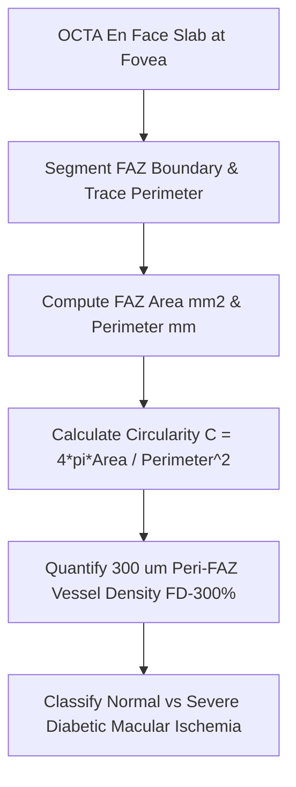

# Ocular OCTA Foveal Avascular Zone (FAZ) Personal Agent Skill

[](LICENSE)
[](https://www.python.org/)
[]()
[]()
[]()

Deterministic, zero-mock personal agent micro-skill for calculating Optical Coherence Tomography Angiography (OCTA) Foveal Avascular Zone Area ($A_{\text{FAZ}}$), Perimeter ($P_{\text{FAZ}}$), Circularity Index ($C$), and Parafoveal Capillary Density (FD-300%).

## Architecture



## Quickstart

```python
from client import OCTAFovealAvascularZoneClient

client = OCTAFovealAvascularZoneClient()
result = client.evaluate_faz(
    faz_area_mm2=0.28,
    faz_perimeter_mm=2.05,
    parafoveal_fd300_density_pct=53.5
)
print(result)
```

## License

Apache-2.0
